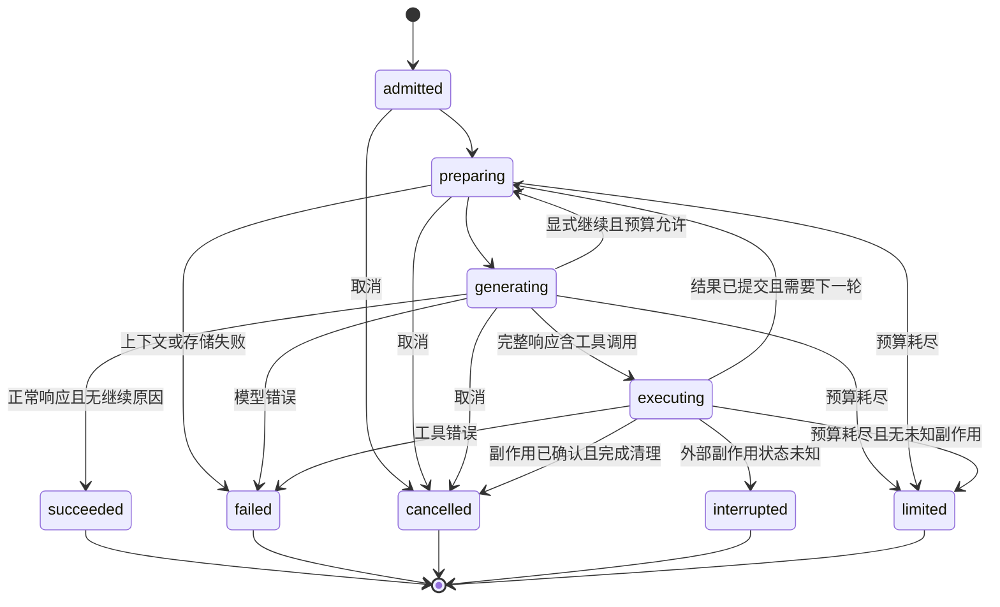

# Agent Loop 设计

状态：设计提案。实现目标：现有 Python/FastAPI 后端。
Pi 对照基线：b64e6badd6ddefda17fc7f6286c013467186d8a1。

## 责任边界

Loop 管理一次输入到最终响应的运行过程。Tool executor 管理一次能力调用。
业务服务管理资源归属、数据事务和外部副作用。

以 Pi agent-core 的 loop 状态机为行为参考，保留现有 Python 服务端边界。
模型调用使用成熟 Python SDK，具体 SDK 尚未确定；应用负责准入、上下文、预算、工具和持久化。
Pi 的 TypeScript 包不直接作为 Python 依赖。本次没有安装依赖。

术语：

- Conversation：一段对话的历史与运行入口。
- Run：一次被接纳的输入到终态，包含多个 turn。
- Turn：一次模型响应及其工具结果。
- Tool call：模型提出的一次能力调用，具有稳定 callId。

## 状态与所有权

服务端持有 conversationId、runId、认证主体、配置版本和取消控制器。
模型参数只表达任务数据。认证主体、租户和权限来自已认证请求。

一个 conversation 同时只有一个 active run。并发输入进入有界 FIFO 队列。
每次准入分配 requestId；重复 requestId 且输入摘要相同时复用已有 run。
相同 requestId 携带不同输入时拒绝。
应用存储通过唯一约束与原子状态更新保证准入，不依赖单个 Agent 实例的内存标志。

持久记录：

- Run：输入标识、配置版本、状态、终止原因、用量和最终事件游标。
- Transcript：system/user/assistant/toolResult 的已完成消息。
- Tool receipt：见 [Tool 设计](03-tool-design.md)。
- Inbox：被接纳但尚未消费的输入。

流式 assistant 草稿和工具进度属于临时展示。
已完成消息和工具收据提交成功后才能发布为确定结果。
客户端重连通过快照和已提交事件恢复；草稿允许丢弃。

这项一致性等级是本提案的选择。
当前 Pi durable 的 partial 默认约每 100 ms 更新可见状态，可延迟最多约 1,000 ms 存储。
这段窗口内的进度及部分用量可能因崩溃丢失；确定业务结果需要独立的持久化边界。
相关证据见 [Pi 调研](01-pi-runtime-research.md)。

## 状态转换

interrupted 表示需要核对业务事实；该状态禁止自动重放写操作。

## 每轮执行顺序

1. 校验 active run 的所有权、取消状态、deadline 和剩余预算。
2. 按安全边界消费输入，固定本轮配置与工具清单快照。
3. 从已提交历史生成模型上下文。
4. 发出 turn_start，再发起一次模型请求。
5. 流式展示草稿，等待完整 assistant 响应。
6. 先提交完整 assistant 消息，再处理其工具调用。
7. 通过统一 executor 调度调用，提交工具结果。
8. 结算用量并执行 finishTurn 决策。
9. 发出 turn_end，决定下一轮或提交 run 终态。

Pi 对照点：prepareRequest 在每次请求前运行；finishTurn 位于整批工具结果之后。
Agent.subscribe 和 runAgentLoop 的 awaited sink 可建立 message_end 持久化屏障。
低层 agentLoop 的 EventStream 消费者没有该等待保证。
Pi 的 prompt()/waitForIdle() 完成后才释放实例运行槽位。

Python 实现需要显式 await 持久化，再调用 executor；终态提交后才能释放应用运行槽位。
存储失败立即停用当前执行实例，禁止发布成功或继续准入。
存储不可用时无法承诺终态已落盘；恢复存储后按运行记录和业务收据对账。
Pi 监听者抛错可能触发合成失败事件，关键持久化处理不得重入同一失败写入路径。

Pi 的 awaited 订阅机制会让慢监听者阻塞 loop。持久化属于关键路径。
客户端推送使用有界队列；慢客户端断连后通过快照重连。

## 继续与结束

继续条件按顺序判定：

- 模型 error/aborted：立即终止。
- 任一工具结果 isError：本提案采用 fail-fast，结束当前 run。
- 预算耗尽或宿主要求结束：终止。
- 存在成功工具结果且本轮未要求终止：下一次模型请求消费结果。
- 有 steering：消费后继续。
- 正常收尾且有 follow-up：先提交当前 run 终态，再由宿主准入新 run。
- 有一次显式 continue：恰好补足一次请求。
- 其余情况：成功终止。

Pi 的 terminate=true 要求全批结果一致。应用的强制结束使用 finishTurn 的 end。
业务拒绝、校验错误和未知工具都形成明确失败；本设计没有自动“修复参数再执行”分支。
串行模式在 tool_execution_end 的关键订阅者中置 run 失败标志；后续 beforeToolCall 读取该标志并阻止执行。
并行读批次中已启动的调用需要取消或等待结算，失败后不进入新的 turn。
仅在 finishTurn 返回 end 无法阻止同批后续工具，这项集成必须单独验证。

模型输出达到 length 上限时，整条响应内的工具调用都禁止执行。
本提案结束为 limited，并保存完整的停止原因。
Pi 对截断调用生成错误后默认仍可继续；对应策略需在 finishTurn 显式返回 end。
完整的模型响应结束前，toolcall_delta 只用于展示。

## 事件契约

应用事件包含 schemaVersion、conversationId、runId、turnId、type、timestamp。
工具事件额外包含 toolCallId；确定事件包含服务端单调 seq。
消息内容按 event type 校验，禁止暴露原始认证上下文。

确定事件在对应状态提交后发布，通过 seq 去重和重连。
草稿 delta 带本次连接的 draftId，与确定消息使用不同展示状态。
终态带 succeeded/failed/cancelled/limited/interrupted 原因。
事件在关键监听者完成后才算结算；不能把 agent_end 当作数据库提交证明。

## 调度与输入队列

默认整轮 sequential，符合 Pi 的现成调度能力。
只有显式声明可并行、相互独立、无副作用的读工具批次允许 parallel。
一轮中出现 sequential 工具，整轮串行。
模型在同一响应中声明的调用没有可执行依赖图；依赖前一个结果的调用必须留到下一轮。

Pi parallel 使用 Promise.all；单批没有内置并发上限。
应用限制本轮 call 数，不能仅把全局调度改成 parallel。
跨 run 的资源配额由服务端宿主管理。

steering 在请求前或整批工具完成后接入。
它不会撤销已执行的工具，也不会保证打断本轮模型请求。
取消请求使用独立取消入口。
本项目 follow-up 由宿主的有界持久 inbox 保存，在自然收尾后准入新 run。
Pi 原生 follow-up 在同一次 loop/run 内消费，两个内存队列均没有容量和持久化保证。
二者的 run 归属需在集成边界明确，不能直接用 Agent.followUp 代替应用 inbox。
Pi 的 prepareRequest 执行后不再重新轮询 steering；此期间到达的输入等待下一个安全边界。

## 预算、取消和恢复

宿主必须配置有限的 maxTurns、maxToolCalls、maxCallsPerTurn、deadline、模型输出上限和结果字节上限。
具体数字属于待测配置；本次没有负载或 token 实测依据。
在每次模型请求和每次工具执行前复查，不能只在 turn_end 检查。
按完整 assistant 调用清单计入未知与无效工具；这些调用不会进入 Pi 的 beforeToolCall。
Pi durable 的 maxTurns 按工具轮计数，continuation 可能重置计数；应用另行限制模型请求总数。
Pi 的 context-only continue 可能没有新用户消息，实际供应商兼容性需验证。
流式用量缺失时，成本限额只能作为估算保护；硬保护依赖请求次数和供应商输出限制。

取消传播到模型请求、executor 和业务客户端。
工具需主动响应 signal，HTTP 请求配置 deadline。
清理完成前保持运行槽位；已发出的外部写操作结果不明确时进入 interrupted。

进程重启后：

- 被接纳但未开始的输入，可以重新调度。
- 已开始的模型请求标记 interrupted，重新生成需使用明确的新尝试记录。
- 工具从 intent/result 收据判断状态，执行 [重放规则](03-tool-design.md#崩溃恢复与幂等)。
- 已存在未知写结果的 run 禁止恢复成普通对话继续。

本方案承诺输入去重和副作用可核对。无透明的 mid-token 恢复保证。

## 上下文投影

保留完整业务审计，单独生成有限长度的模型上下文。
裁剪以完整 turn 为单位，保留成对的 toolCall/toolResult。
系统提示、工具 schema 版本与工具实际可执行列表必须一致。
工具结果中的外部文本视为不可信数据。

价格、权限、资源状态和审批凭证在执行时从业务系统取得。
摘要没有授权效力。上下文超限直接结束；自动摘要压缩尚无业务需求依据。

## 设计验收

验收用例、Pi 对照测试和待确认问题见 [验证与决策](04-validation-and-decisions.md)。
