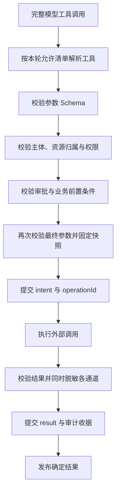

# Tool 设计

状态：设计提案。工具执行发生在受控服务端。

## 两种契约

模型侧看到 name、description 和 JSON Schema。
执行侧额外持有实现、权限策略、超时、输出约束和副作用策略。
模型侧声明与执行侧注册使用同一个定义来源。

本项目面向 Python/FastAPI，建议用 Pydantic 定义输入和程序输出并导出 JSON Schema。
实现前需核对验证库版本并显式声明依赖；本次没有安装或接入验证库。
Pi 当前对照契约是 AgentTool + pi-schema，接受普通 JSON Schema。
常用 TypeBox 1.x JSON Schema 有兼容支持；JavaScript 专用类型、refinement 和 codec 不属于支持范围。
工具名在应用注册表中唯一；重复名称启动失败。
配置和实现版本固定到 run，运行过程中不热替换。

## 最小工具定义

这是领域无关契约草案，字段名属于本项目设计。

- name、description、inputSchema：给模型的能力说明。
- outputSchema：程序可消费结果的约束。
- effect：read 或 write。
- executionMode：默认 sequential。
- replay：默认 never；审核通过的幂等读可声明 safe。
- timeoutMs、maxOutputBytes：有限的调用与结果边界。
- execute(args, context)：执行能力，返回已分类结果。

执行 context 由宿主注入：

- principal、tenantId、conversationId、runId、toolCallId。
- signal、deadline、审计关联标识。
- 服务端生成并持久化的 operationId。

模型不能提供认证主体、工具实现引用、密钥或 operationId。
工具 schema 不暴露服务端权限字段。

Pi agent-core 的结果字段为 content/details/structuredContent/isError/terminate。
Pi durable 使用 output/details/structuredOutput/diagnostics/control。
项目内部使用独立的 Python 结果模型，按职责对照这些字段。
agent-core 的 outputSchema 在所读 loop 执行路径中没有自动运行时校验。
durable 对非法 structuredOutput 的处理区分来源：嵌套调用返回错误；模型调用可仅丢弃该值并报告宿主。
本项目统一执行最终输出校验，违约即 invalid_output。
项目 replay=never 对应 durable 的 unsafe；两套字面值需要显式映射。

## 统一执行管线

任何失败都阻止进入下一执行节点。
模型调用与程序内部调用都经过该入口。
工具注册表、before hook 和模型可见性共同参与准入；业务服务再校验资源权限。
Pi coding-agent 支持同名覆盖，codemode/deferred 工具可通过内部路径调用。
本项目的唯一名称和固定版本是应用约束；内部调用同样完成主体授权。

Pi agent-core 的 beforeToolCall 原地修改参数后不会二次校验。
应用 hook 只允许作出许可或拒绝决定；executor 在真正执行前校验最终参数。
避免把受信任 hook 的可变对象传递给不可信插件。
Pi durable 在 beforeTool 后再次校验最终参数。

本项目输入采用严格验证，禁止隐式改变数量、金额和审批绑定值。
Pi validateToolArguments 使用 coerce=true：例如整数输入“3.5”可变成 3。
严格检查必须覆盖完整 assistant 消息中的原始参数；仅检查 beforeToolCall 的已转换参数无法发现原始类型。
审批和幂等摘要绑定通过严格检查后的最终执行参数。
Pi 校验错误包含 Received arguments；外发错误只保留脱敏错误码和字段路径。

业务检查示例属于假设：若未来存在修改资源的工具，
执行时检查当前版本、操作权限和审批范围，并由业务事务提交。
当前仓库没有商品、订单或支付实现证据。

## 调用记录与结果

每个 call 保存：

- runId、turnId、toolCallId、工具名称和实现/schema 版本。
- 最终参数的脱敏快照及规范化摘要。
- operationId、effect、重放策略、deadline。
- 状态与时间：intent、running、succeeded、failed、interrupted。
- 可核对的业务回执、错误码、输出引用和耗时。

同一 run 的 toolCallId 唯一。
重复 callId 携带相同参数时读取原收据；参数不同则拒绝。
新的 callId 不代表新的业务意图；写工具还需业务级去重约束。

模型结果只含完成任务必要的数据。
程序结果必须符合 outputSchema。
最终后处理完成后统一校验所有输出，禁止后续 hook 绕过结果约束。
UI details 与审计记录也执行脱敏和访问控制。
“未发送给模型”的数据仍可能进入持久化和客户端。

结果超过限制时返回截断标志与受控引用。
引用获取重新检查访问权限。禁止输出密钥、完整内部栈或任意服务器路径。

## 错误分类

- invalid_arguments：Schema 不符，零业务调用。
- tool_unavailable：不在本轮清单内，零业务调用。
- forbidden：主体或资源权限不足，零副作用。
- approval_required：缺少有效审批，零副作用。
- precondition_failed：资源版本或业务状态已变化。
- timeout / aborted：按执行阶段判断外部结果是否确定。
- interrupted：操作可能已发生，必须核对。
- invalid_output：返回结果违反契约。
- infrastructure_failed：存储或执行基础设施失败，终止 run。

已知业务拒绝通过显式结果表达。非预期程序错误直接失败。
本提案对工具错误采用 fail-fast；串行批次阻止尚未开始的调用，并在轮次边界结束 run。
Pi 的 finishTurn 可结束 run，单独使用它无法阻止同批后续工具。
并行读中已启动的调用需要取消或等待结算。
Pi 原生会将执行异常转换为 isError，默认仍可能让模型继续。
集成验收必须证明应用的终止策略确实生效。

未知写结果禁止简化成普通 timeout 后重新调用。
invalid_output 发生在写操作之后时，也可能需要按 operationId 核对事实。

## 并发与超时

项目默认串行。并发仅开放给已审查的独立读工具。
Pi 原生默认 parallel；terminate 需全批结果一致，单项失败没有整批立即停止保证。
资源写冲突通过业务数据库条件更新或事务解决。
Agent 的运行互斥无法约束其他实例、人工操作或后台任务。

工具超时必须传到真实 I/O。
仅使用 Promise.race 不会停止底层副作用。
工具忽略取消时，宿主不能宣称其已停止；继续保留运行占用并记录异常。
确有不可信计算需求时再选择进程隔离，当前设计不开放任意脚本工具。

## 崩溃恢复与幂等

关键窗口：业务操作已成功，runtime 的 result 尚未写入，进程崩溃。

执行前提交 intent；intent 记录本次 operationId 和最终参数。
恢复时按以下规则处理：

- 已有 result：返回已存结果。
- 没有 intent：可以按正常准入处理。
- 有 intent 且无 result，read 且记录时和当前实现都允许 safe：重新校验当前权限后重试。
- 有 intent 且无 result，write：先按 operationId 查询业务系统。
- 查询确认成功：补记相同回执。
- 查询确认未执行，业务 API 支持相同 operationId 幂等：可按业务协议再次提交。
- 事实无法确认：保留 interrupted，禁止自动重放。

operationId 由服务端生成，跨尝试保持不变。
业务系统需原子约束幂等键与操作参数摘要；相同键携带不同参数必须拒绝。
runtime 的 intent/result 不能与远端业务写操作组成单机原子事务。
exactly-once 需要业务系统协议支撑；本次没有该能力的证据。

Pi durable 对此提供默认 unsafe、双重 safe 检查和 interrupted 结果，
它不自动提供外部业务幂等。
durable 的 intent checkpoint 保存最终参数与 safe/unsafe 策略，项目 operationId 和业务授权需要另行保存。
此外，durable 恢复 safe 工具时不重跑 beforeTool 或参数校验；
敏感资源工具仍需在执行体内校验当前权限。

## 写操作审批

审批状态保存在服务端，绑定主体、资源、操作、参数摘要和有效期。
审批在真正执行前核验，并按业务协议消费。
模型文本中的“用户已同意”不具有审批效力。

待用户审批时结束当前 run，并保存待审批操作。
审批成功后通过新输入触发受控执行。
长期挂起工具 Promise 不承担审批存储责任。

## 当前开放范围

业务工具集合由产品能力清单确定。
当前设计没有注册 bash、任意文件写入、动态代码执行或通用出站 HTTP 能力。
网络地址、资源 ID 和输出路径都需在对应工具的边界完成验证。
